# Database schema (MySQL 8)

Tables are generated by Hibernate from the JPA entities (`spring.jpa.hibernate.ddl-auto=update` in development).
**There is no Flyway/Liquibase migration yet** – before production, generate a baseline migration from a running schema and switch to `validate`.

## Create the database
```sql
CREATE DATABASE mamacare CHARACTER SET utf8mb4 COLLATE utf8mb4_0900_ai_ci;
CREATE USER 'mamacare'@'localhost' IDENTIFIED BY 'choose-a-strong-password';
GRANT ALL PRIVILEGES ON mamacare.* TO 'mamacare'@'localhost';
```

## ER diagram

```mermaid
erDiagram
    USERS ||--o| PATIENT_PROFILES : has
    USERS ||--o| DOCTOR_PROFILES : has
    USERS ||--o| CARETAKER_PROFILES : has
    USERS ||--o| DOCTOR_VERIFICATIONS : "doctor submits"
    USERS ||--o{ PREGNANCIES : "patient has"
    USERS ||--o{ HEALTH_OBSERVATIONS : "patient records"
    USERS ||--o{ MEDICAL_RECORDS : "patient owns"
    USERS ||--o{ MEDICATIONS : "patient takes"
    USERS ||--o{ APPOINTMENTS : "patient / doctor"
    USERS ||--o{ DOCTOR_PATIENT_LINKS : "patient / doctor"
    USERS ||--o{ CARETAKER_ACCESS : "patient / caretaker"
    MEDICATIONS ||--o{ MEDICATION_REMINDERS : schedules
    MEDICATION_REMINDERS ||--o{ MEDICATION_INTAKES : "marked taken"
    USERS ||--o{ AUDIT_LOGS : "actor (soft ref)"

    USERS { bigint id PK
            varchar email UK
            varchar password_hash
            enum role "PATIENT DOCTOR CARETAKER ADMIN"
            enum status "ACTIVE PENDING REJECTED SUSPENDED"
            int token_version }
    PREGNANCIES { bigint patient_id FK
                  date lmp_date
                  date due_date
                  enum due_date_source
                  enum status }
    HEALTH_OBSERVATIONS { bigint patient_id FK
                          enum type
                          double measurement
                          double secondary_value
                          varchar unit
                          datetime observed_at }
    APPOINTMENTS { bigint patient_id FK
                   bigint doctor_id FK
                   datetime scheduled_at
                   enum status }
    DOCTOR_PATIENT_LINKS { bigint patient_id FK
                           bigint doctor_id FK
                           enum status "UK patient+doctor" }
    CARETAKER_ACCESS { bigint patient_id FK
                       bigint caretaker_id FK
                       enum status
                       bool can_view_health
                       bool can_view_medications
                       bool can_view_appointments
                       bool can_view_records }
    MEDICAL_RECORDS { bigint patient_id FK
                      bigint uploaded_by FK
                      enum type
                      varchar storage_key "private, never exposed" }
    MEDICATIONS { bigint patient_id FK
                  bigint prescribed_by FK "null = self-entered"
                  varchar name
                  bool active }
    MEDICATION_REMINDERS { bigint medication_id FK
                           time time_of_day "UK medication+time" }
    MEDICATION_INTAKES { bigint reminder_id FK
                         date intake_date "UK reminder+date" }
```


## Constraints and indexes
| Table | Unique | Indexes |
|---|---|---|
| users | `email` | `(role,status)` |
| patient/doctor/caretaker_profiles | `user_id` | – |
| doctor_verifications | `doctor_id` | `status` |
| pregnancies | – | `(patient_id,status)` |
| health_observations | – | `(patient_id,type,observed_at)` |
| appointments | – | `(doctor_id,scheduled_at)`, `(patient_id,scheduled_at)` |
| doctor_patient_links | `(patient_id,doctor_id)` | `(doctor_id,status)` |
| caretaker_access | `(patient_id,caretaker_id)` | `(caretaker_id,status)` |
| medical_records | – | `(patient_id,record_date)` |
| medications | – | `(patient_id,active)` |
| medication_reminders | `(medication_id,time_of_day)` | – |
| medication_intakes | `(reminder_id,intake_date)` | – |
| audit_logs | – | `actor_id`, `created_at` |

All tables carry `id`, `created_at`, `updated_at`. Timestamps are stored in UTC. Foreign keys are real FK constraints except
`audit_logs.actor_id` (intentionally a soft reference so the trail survives user deletion).

Transactions: every service method that writes is `@Transactional`; audit rows use `REQUIRES_NEW`.
Known design limits: 30-minute fixed appointment slots; one doctor-slot conflict check is not backed by a DB constraint (a race could double-confirm).
